

# 🧑‍🎓 JongYun Choi

**디지털 포렌식 및 정보보안 연구자**  
한성대학교 대학원 융합보안학과

✦ Digital Forensics · Cloud & Groupware Forensics · AI Data Forensics ✦

 

  

🌙 · ✦ · 🪐 · ✧ · ⭐

---

## 🎓 Education

<table>
<tr><td width="80" align="center"></td><td><b>M.S. in Information Security</b> Department of Convergence Security Hansung University, Korea Graduate Student</td></tr>
<tr><td align="center"></td><td><b>B.S. in Software &amp; Service Computing</b> Department of Software &amp; Service Computing Hankyong National University, Korea</td></tr>
</table>

---

## 🏆 Honors & Awards

### 🌙 2026

<table width="760"><tr><td width="580" valign="top">

**✦ 01. 최우수 정보보호학회장상**

**학회 / 대회**  
2026 한국정보보호학회 동계학술대회

**논문**  
Hiworks Messenger의 Socket.IO 기반 통신 프로토콜 역공학을 통한 메신저 데이터 획득

**수상자 / 저자**  
신민석, 김한결, <b>최종윤</b>, 박명서

**수상일**  
2026-10-28

</td><td width="180" align="center" valign="middle">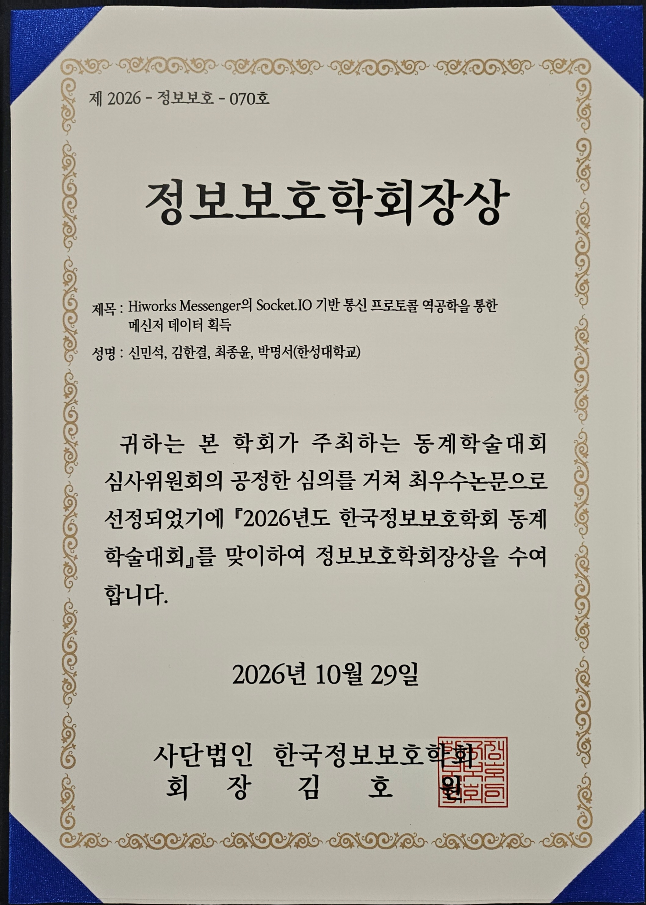</td></tr></table>

<table width="760"><tr><td width="580" valign="top">

**✦ 02. 한국방송통신전파진흥원장상(KCA)**

**학회 / 대회**  
2026 제7회 호남 사이버보안 컨퍼런스  
2026 한국정보보호학회 추계학술대회 호남지부

**논문**  
안드로이드 환경에서의 정보은닉 애플리케이션 Private Photo Vault 분석 연구

**수상자 / 저자**  
김대환, 안원석, <b>최종윤</b>, 신민석, 한동균, 박명서

**수상일**  
2026-09-15

</td><td width="180" align="center" valign="middle"></td></tr></table>

<table width="760"><tr><td width="580" valign="top">

**✦ 03. 정보보호학회장상**

**학회 / 대회**  
2026 부채널정보분석경진대회 워크샵

**논문**  
Windows MacOS 환경에서의 Google Drive 내부 API 재구성 기반 선택적 메타데이터 수집 및 숨김 삭제된 파일 획득 자동화 도구 구현

**수상자 / 저자**  
신민석, <b>최종윤</b>, 김한결, 김대환, 박화비, 박명서

**수상일**  
2026-07-01

</td><td width="180" align="center" valign="middle">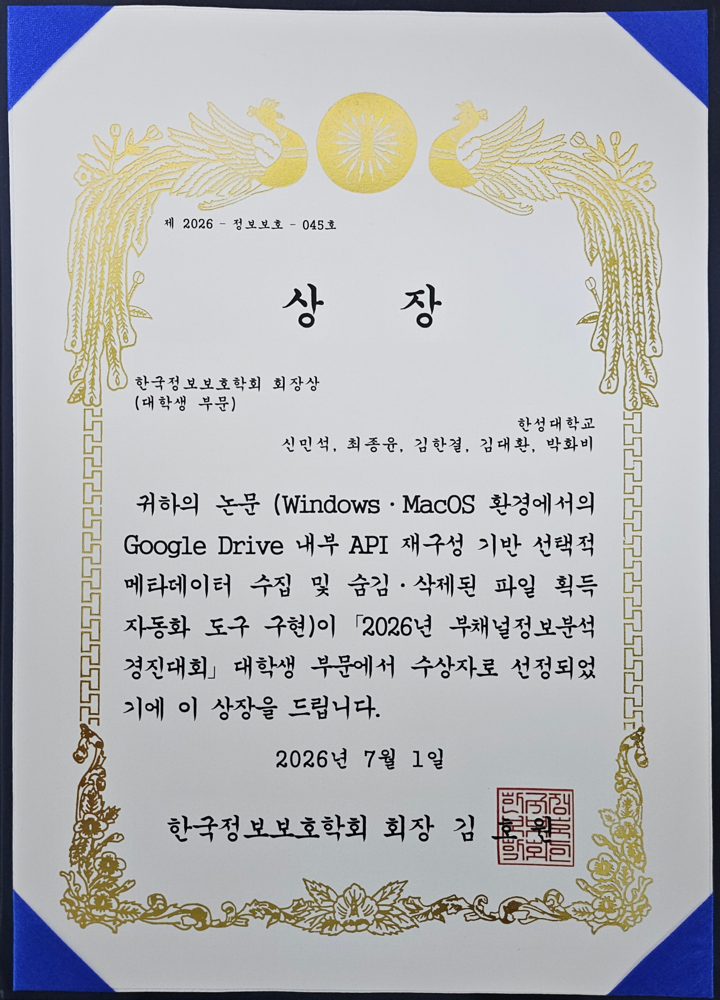</td></tr></table>

<table width="760"><tr><td width="580" valign="top">

**✦ 04. 부채널연구회장상**

**학회 / 대회**  
2026 부채널정보분석경진대회 워크샵

**논문**  
An API-based cloud forensics framework for collaboration tools: A case study of slack

**수상자 / 저자**  
김한결, 위다빈, <b>최종윤</b>, 박명서

**수상일**  
2026-07-01

</td><td width="180" align="center" valign="middle">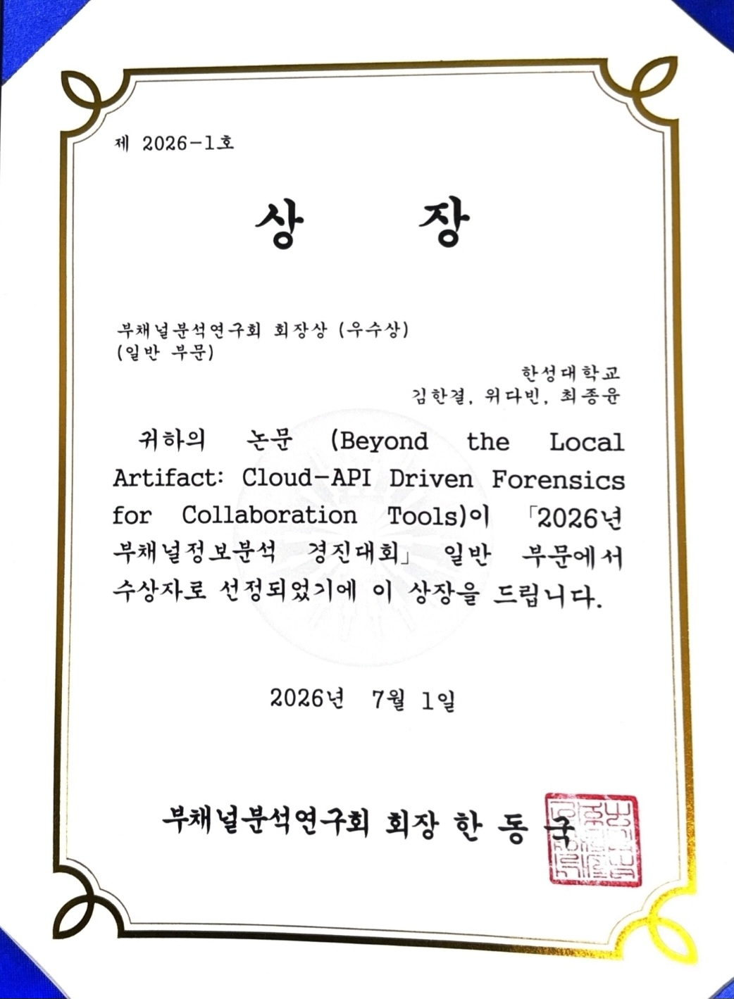</td></tr></table>

### ⭐ 2025

<table width="760"><tr><td width="580" valign="top">

**✦ 05. 우수 정보보호학회장상**

**학회 / 대회**  
2025년도 한국정보보호학회 동계학술대회

**논문**  
CLOVA Note API 기반 음성 포렌식 및 발화 분석 연구

**수상자 / 저자**  
<b>최종윤</b>, 신민석, 김한결, 위다빈, 박명서

**수상일**  
2025-11-27

</td><td width="180" align="center" valign="middle">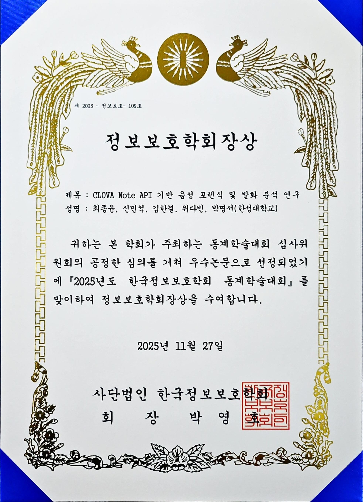</td></tr></table>

<table width="760"><tr><td width="580" valign="top">

**✦ 06. 한국전자통신연구원(ETRI) 원장상**

**학회 / 대회**  
2025 한국정보보호학회 충청지부 학술대회

**논문**  
그룹웨어 포렌식 기법 연구: Hiworks–DaouOffice 사례

**수상자 / 저자**  
신민석, <b>최종윤</b>, 장규영, 김한결, 김동인, 박명서

**수상일**  
2025-09-30

</td><td width="180" align="center" valign="middle">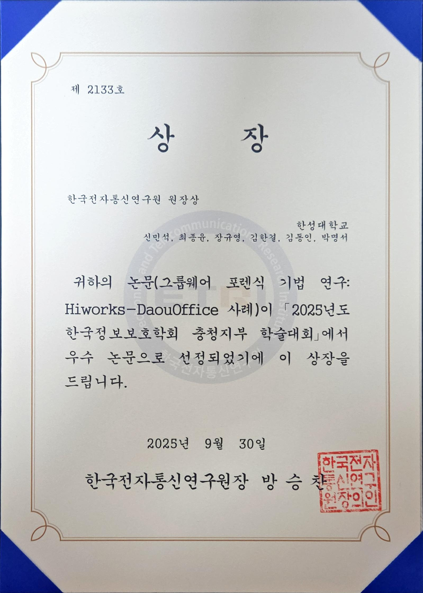</td></tr></table>

<table width="760"><tr><td width="580" valign="top">

**✦ 07. 한국포렌식학회 논문경진대회 은상**

**학회 / 대회**  
2025 제2회 논문경진대회

**논문**  
조직 내부 데이터 압수 수색을 위한 그룹웨어 포렌식 기술 연구: DaouOffice를 중심으로

**수상자 / 저자**  
<b>최종윤</b>

**수상일**  
2025-09-23

</td><td width="180" align="center" valign="middle">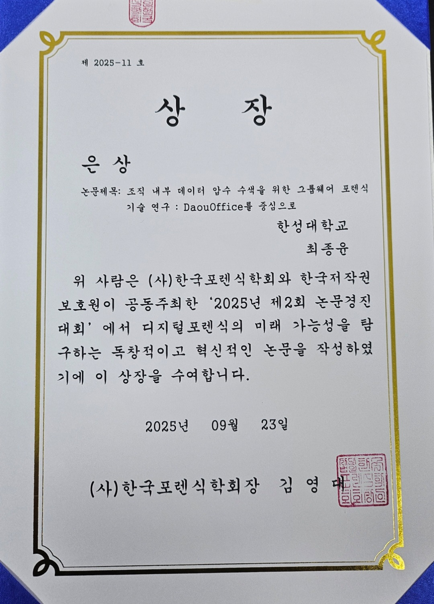</td></tr></table>

<table width="760"><tr><td width="580" valign="top">

**✦ 08. 한국방송통신전파진흥원장상(KCA)**

**학회 / 대회**  
2025 제6회 호남 사이버보안 컨퍼런스  
2025 한국정보보호학회 추계학술대회 호남지부

**논문**  
Wrtn API 재구성에 기반한 생성형 AI 대화 기록물 포렌식 수집과 재현성 검증

**수상자 / 저자**  
<b>최종윤</b>, 신민석, 김동인, 김한결, 박명서

**수상일**  
2025-09-18

</td><td width="180" align="center" valign="middle">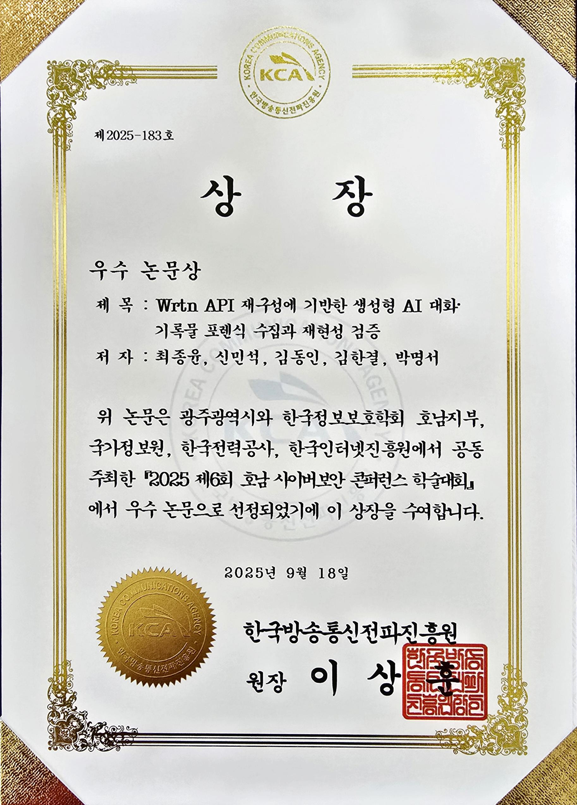</td></tr></table>

<table width="760"><tr><td width="580" valign="top">

**✦ 09. 정보보호학회 호남지부장상**

**학회 / 대회**  
2025 제6회 호남 사이버보안 컨퍼런스 추계학술대회

**논문**  
생성형 AI 기반 Perplexity 대화 데이터 획득 방안 연구

**수상자 / 저자**  
신민석, <b>최종윤</b>, 김한결, 위다빈, 박명서

**수상일**  
2025-09-18

</td><td width="180" align="center" valign="middle">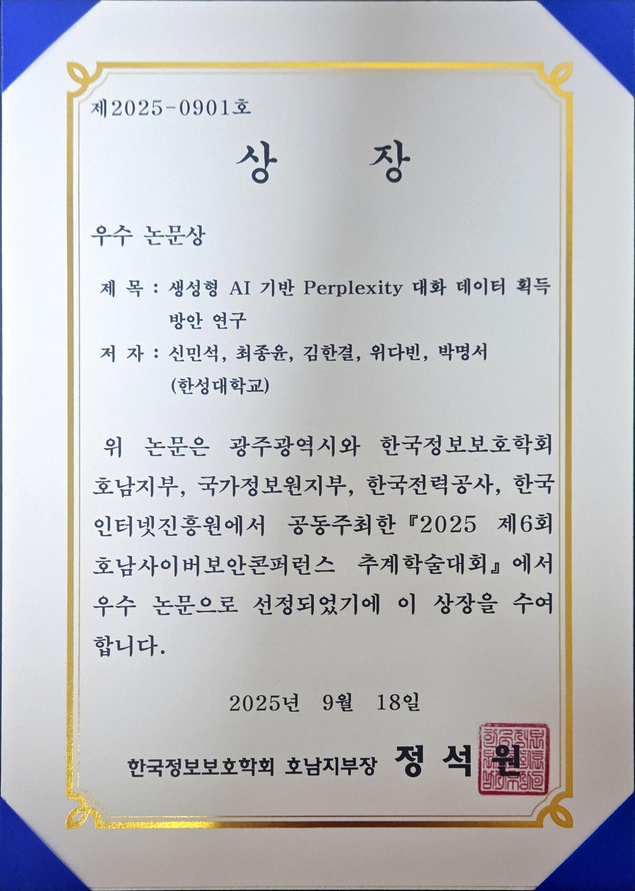</td></tr></table>

---

## 🎤 Conference Presentations

<b>📚 학술대회 발표 논문 전체 보기 · 18편 (클릭하여 펼치기)</b>

 

### 🌙 2026 (10편)

#### ✦ KDFS-W 2026

<table width="760"><tr><td>
<b>소셜 미디어 기반 Instagram DM 데이터 획득 및 포렌식 분석 연구</b> Authors: <b>최종윤</b>, 장규영, 신민석, 김한결, 박명서

<b>기업용 그룹웨어 메신저 A의 접근통제 취약점 분석과 사용자 데이터 보안 위협에 관한 연구</b> Authors: 신민석, 김한결, <b>최종윤</b>, 박명서
</td></tr></table>

#### ✦ CISC-W 2026

<table width="760"><tr><td>
<b>Hiworks Messenger의 Socket.IO 기반 통신 프로토콜 역공학을 통한 메신저 데이터 획득</b> Authors: 신민석, 김한결, <b>최종윤</b>, 박명서

<b>국가안보 관점에서 바라본 디지털 포렌식 기술 연구</b> Authors: <b>최종윤</b>, 김대환, 신민석, 김한결, 박명서
</td></tr></table>

#### ✦ HONAM 2026

<table width="760"><tr><td>
<b>클라우드 세션 크리덴셜 기반 Daglo 포렌식 분석 연구</b> Authors: <b>최종윤</b>, 신민석, 김대환, 박명서

<b>안드로이드 환경에서의 정보은닉 애플리케이션 Private Photo Vault 분석 연구</b> Authors: 김대환, 안원석, <b>최종윤</b>, 신민석, 한동균, 박명서
</td></tr></table>

#### ✦ KDFS-S 2026

<table width="760"><tr><td>
<b>iOS 환경의 사용자 암호 기반 Vault 애플리케이션에 대한 복호화 연구</b> Authors: 위다빈, 안원석, <b>최종윤</b>, 김대환, 신민석, 박명서

<b>음성 포렌식을 위한 한국어 음성 기반 특정 발화자 구분:유성 발화 구간 지속 시간 특징의 활용</b> Authors: 장규영, <b>최종윤</b>, 김대환, 박명서
</td></tr></table>

#### ✦ CISC-S 2026

<table width="760"><tr><td>
<b>Google Drive 서비스의 API 재구성 기반 선택적 데이터 수집 및 숨김·삭제 파일 메타데이터 획득 연구</b> Authors: 신민석, <b>최종윤</b>, 김한결, 김대환, 박명서

<b>상담 음성 기반 프로파일 화자 분리 및 발화 재구성 연구</b> Authors: <b>최종윤</b>, 신민석, 김대환, 김한결, 박명서
</td></tr></table>

### ⭐ 2025 (8편)

#### ✦ CISC-S 2025

<table width="760"><tr><td>
<b>불법 스포츠 스트리밍 사이트 탐지를 위한 텍스트 키워드 기반 랜덤 포레스트 모델 설계</b> Authors: <b>최종윤</b>, 김한결, 박명서

<b>크리덴셜 마이그레이션을 활용한 MYBOX 탐색기 대상의 클라우드 포렌식 연구</b> Authors: 김한결, 위다빈, 안원석, <b>최종윤</b>, 박명서
</td></tr></table>

#### ✦ KIISCCC 2025

<table width="760"><tr><td>
<b>그룹웨어 포렌식 기법 연구: Hiworks–DaouOffice 사례</b> Authors: 신민석, <b>최종윤</b>, 장규영, 김한결, 김동인, 박명서
</td></tr></table>

#### ✦ HONAM 2025

<table width="760"><tr><td>
<b>Wrtn API 재구성에 기반한 생성형 AI 대화 기록물 포렌식 수집과 재현성 검증</b> Authors: <b>최종윤</b>, 신민석, 김동인, 김한결, 박명서

<b>알림 저장 앱을 활용한 모바일 메신저 아티팩트 분석</b> Authors: 김동인, <b>최종윤</b>, 박명서

<b>생성형 AI 기반 Perplexity 대화 데이터 획득 방안 연구</b> Authors: 신민석, <b>최종윤</b>, 김한결, 위다빈, 박명서
</td></tr></table>

#### ✦ CISC-W 2025

<table width="760"><tr><td>
<b>CLOVA Note API 기반 음성 포렌식 및 발화 분석 연구</b> Authors: <b>최종윤</b>, 신민석, 김한결, 위다빈, 박명서

<b>오픈소스 기반 Yurei 랜섬웨어에 대한 동작 분석 및 연관성 식별 연구</b> Authors: 김한결, 위다빈, <b>최종윤</b>, 신민석, 박명서
</td></tr></table>

---

## 📄 Publications

### International Journal

#### 🌙 2026

<table width="760"><tr><td width="580" valign="top">

**제목**  
An API-based cloud forensics framework for collaboration tools: A case study of Slack

**저자**  
Hangyeol Kim, Dabin We, <b>Jongyun Choi</b>, Myungseo Park

**학회**  
Forensic Science International: Digital Investigation · Vol. 58 · 2026

**논문 링크**  
<a href="https://www.sciencedirect.com/science/article/abs/pii/S2666281726001526">논문 보기 ↗</a>

</td><td width="180" align="center" valign="middle"><a href="https://www.sciencedirect.com/science/article/abs/pii/S2666281726001526">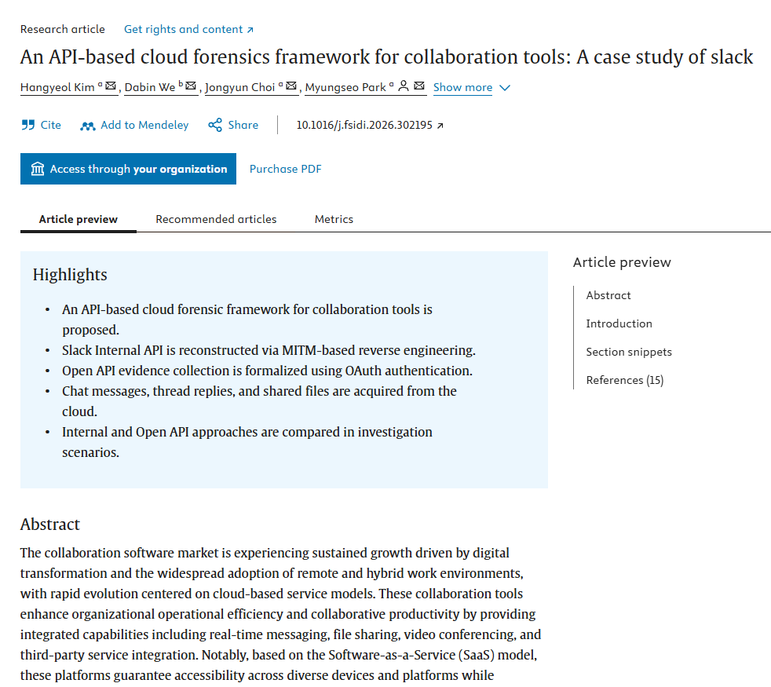</a></td></tr></table>

### Domestic Journals

#### 🌙 2026

<table width="760"><tr><td width="580" valign="top">

**제목**  
생성형 AI 대화 데이터의 수집 및 분석 연구: Wrtn과 Perplexity 애플리케이션 중심으로

**저자**  
<b>최종윤</b>, 신민석, 김동인, 김한결, 박명서

**학회**  
정보보호학회논문지 · 36(4) · pp. 1443–1463 · 2026

**논문 링크**  
<a href="https://www.dbpia.co.kr/journal/articleDetail?nodeId=NODE12942138">논문 보기 ↗</a>

</td><td width="180" align="center" valign="middle"><a href="https://www.dbpia.co.kr/journal/articleDetail?nodeId=NODE12942138">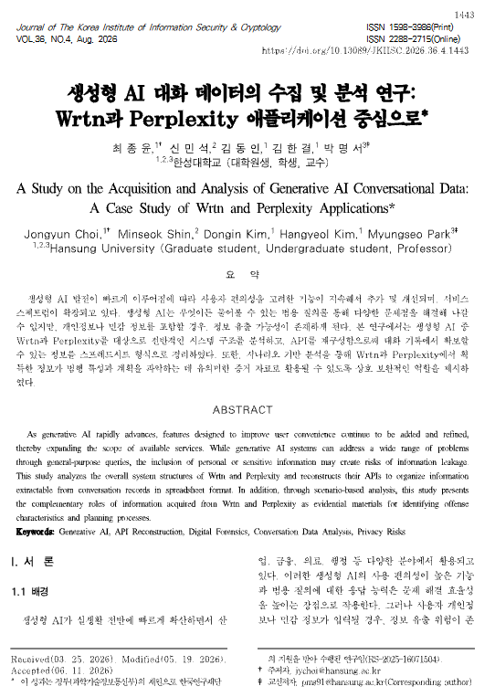</a></td></tr></table>

<table width="760"><tr><td width="580" valign="top">

**제목**  
알림 저장 애플리케이션을 이용한 메신저 애플리케이션 데이터 수집 및 분석 연구

**저자**  
김동인, <b>최종윤</b>, 김한결, 박명서

**학회**  
디지털포렌식연구 · 20(3) · pp. 126–152 · 2026

**논문 링크**  
<a href="https://www.dbpia.co.kr/journal/articleDetail?nodeId=NODE12904434">논문 보기 ↗</a>

</td><td width="180" align="center" valign="middle"><a href="https://www.dbpia.co.kr/journal/articleDetail?nodeId=NODE12904434">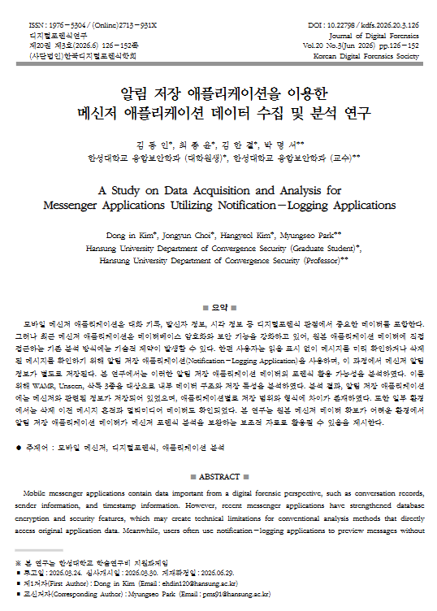</a></td></tr></table>

<table width="760"><tr><td width="580" valign="top">

**제목**  
암호화된 Notes 애플리케이션 데이터 수집 및 복호화 방법 연구 - macOS 15 버전 이상 환경을 중심으로

**저자**  
김대환, 위다빈, 김한결, 안원석, 김동인, 장규영, <b>최종윤</b>, 신민석, 임주경, 이인수, 박명서

**학회**  
법과학의신동향 · 통권 13호 · pp. 163–189 · 2026

**논문 링크**  
<a href="https://www.kci.go.kr/kciportal/ci/sereArticleSearch/ciSereArtiView.kci?sereArticleSearchBean.artiId=ART003331390">논문 보기 ↗</a>

</td><td width="180" align="center" valign="middle"><a href="https://www.kci.go.kr/kciportal/ci/sereArticleSearch/ciSereArtiView.kci?sereArticleSearchBean.artiId=ART003331390">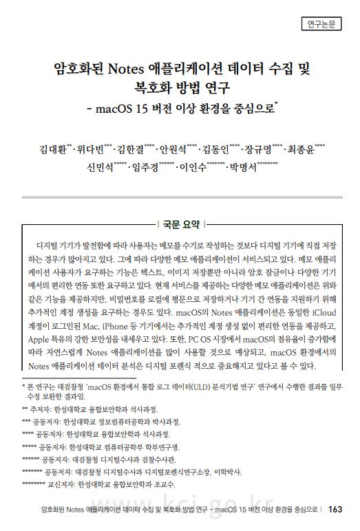</a></td></tr></table>

<table width="760"><tr><td width="580" valign="top">

**제목**  
크리덴셜 마이그레이션을 통한 NAVER MYBOX 클라우드 저장소 접근 기술 연구

**저자**  
김한결, 위다빈, 안원석, <b>최종윤</b>, 박명서

**학회**  
정보보호학회논문지 · 36(1) · pp. 293–305 · 2026

**논문 링크**  
<a href="https://www.dbpia.co.kr/journal/articleDetail?nodeId=NODE12585942">논문 보기 ↗</a>

</td><td width="180" align="center" valign="middle"><a href="https://www.dbpia.co.kr/journal/articleDetail?nodeId=NODE12585942">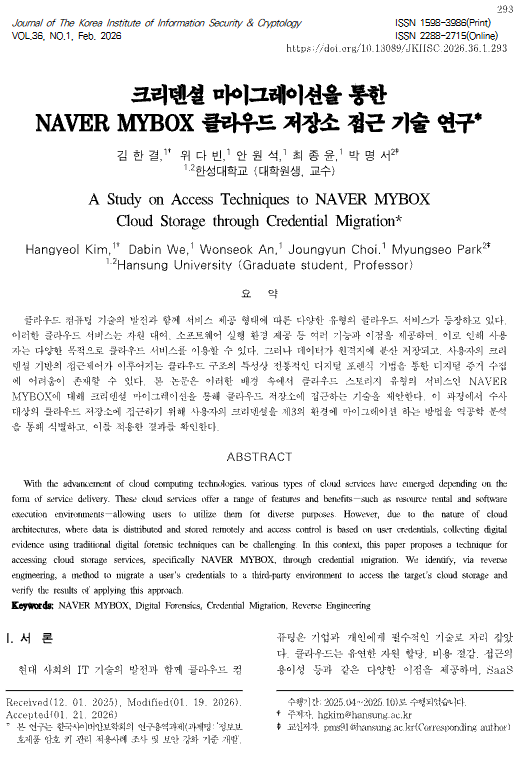</a></td></tr></table>

#### ⭐ 2025

<table width="760"><tr><td width="580" valign="top">

**제목**  
암호화폐 기반 랜섬 머니 지급 흐름과 추적 기술 동향

**저자**  
<b>최종윤</b>, 신민석, 박화비, 한동균, 신준성, 박명서

**학회**  
정보보호학회지 · 35(6) · pp. 41–48 · 2025-12

**논문 링크**  
<a href="https://www.dbpia.co.kr/journal/articleDetail?nodeId=NODE12547751">논문 보기 ↗</a>

</td><td width="180" align="center" valign="middle"><a href="https://www.dbpia.co.kr/journal/articleDetail?nodeId=NODE12547751">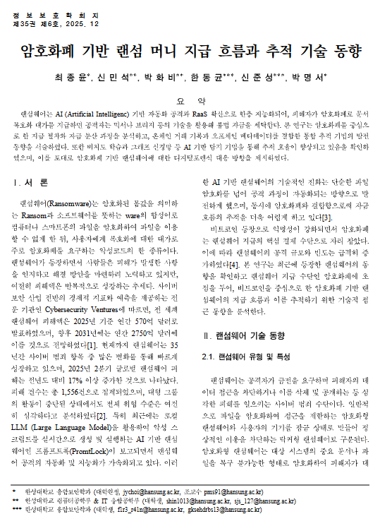</a></td></tr></table>

---

## 🔬 Research Interests

- **Digital Forensics**
- **Mobile App Forensics**
- **Cloud & Groupware Forensics**
- **AI-generated Data Forensics**

---

## 📫 Contact

**Email:** [zheld0412@gmail.com](mailto:zheld0412@gmail.com)

JongYun Choi · Digital Forensics &amp; Security Researcher

